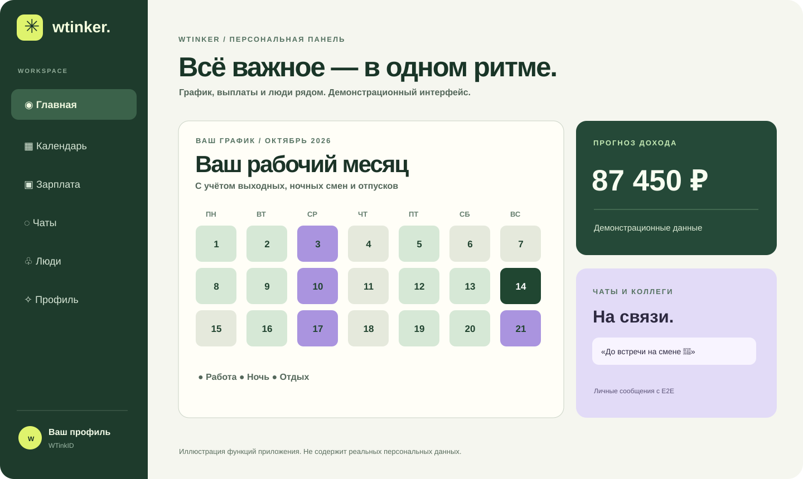

<div align="center">

# ✳ WTinker

### Работа. В одном ритме.

**Смены, зарплата, коллеги и разговоры — одна понятная рабочая среда.**

**[Открыть WTinker](https://skaletun.github.io/WorkerTink/) · [Создать аккаунт](https://skaletun.github.io/WorkerTink/?auth=join) · [Войти](https://skaletun.github.io/WorkerTink/?auth=login)**

[](https://github.com/skaletun/WorkerTink/actions)



<sub>Иллюстрация продукта с демонстрационными данными — не скриншот пользовательского аккаунта.</sub>

</div>

---

## Всё, что нужно в течение рабочего дня

WTinker объединяет профессиональную сеть и Work OS. Больше не нужно держать график, расчёты и рабочие контакты в нескольких приложениях.

| 🗓 **Рабочий ритм** | 💸 **Ваши деньги** | 💬 **Люди и команды** |
| --- | --- | --- |
| Графики 5/2, 4/1, 3/2, 3/1, 6/1, 2/2 и вахты 7/0. | Оклад, НДФЛ, ночные и праздничные доплаты. | WTinkID, username, друзья, сообщества, публикации. |
| Редактор смен, календарь и напоминания. | Аванс, остаток, годовой прогноз. | Личные E2E-чаты, вложения, групповые обсуждения. |
| Отпуска, больничные, заметки и история. | Отпускные и больничные по заданным параметрам. | Корпоративные каналы, команды и документы. |

## Начните за три шага

1. **Создайте рабочий профиль.** Имя, должность, уникальный WTinkID и вход с PIN или OnePass.
2. **Настройте график и доход.** Рабочие параметры можно изменить в любой момент — изменения сохраняются и влияют на расчёты.
3. **Найдите своих людей.** Знакомьтесь, отправляйте заявки, переписывайтесь и сотрудничайте.

<div align="center">

**[Начать бесплатно — открыть веб-приложение →](https://skaletun.github.io/WorkerTink/?auth=join)**

</div>

## PWA: рабочая система в кармане

Установите WTinker из браузера на телефон или компьютер. Календарь, график, расчёты и локальные записи доступны офлайн после загрузки приложения. Синхронизация профиля и рабочей настройки, друзья, социальная сеть и чаты требуют связи с Directory API.

### Приватность без иллюзий

- **На устройстве:** подробные локальные рабочие записи, расчёты, заметки и E2E-ключи.
- **В аккаунте:** публичный профиль, связи, настройки оформления QR, зашифрованные параметры рабочих условий.
- **На сервере чатов:** шифротексты сообщений и вложений, а также технические метаданные, необходимые для доставки.
- **Для уведомлений:** даты и типы напоминаний могут синхронизироваться с сервером при использовании функции.

Подробнее: [Политика конфиденциальности](https://skaletun.github.io/WorkerTink/rules/privacy) · [Условия использования](https://skaletun.github.io/WorkerTink/rules/terms). Документы требуют проверки юридических реквизитов оператора до использования как окончательной правовой редакции.

> WTinker — инструмент личного планирования. Расчёт зарплаты, налогов и больничных носит справочный характер и не заменяет сведения работодателя или правовую консультацию.

## Под капотом

| Компонент | Технологии |
| --- | --- |
| Веб-приложение | React 19, TypeScript, Vite |
| Установка и офлайн | PWA, Service Worker, Cache API |
| Социальная сеть и аккаунты | Cloudflare Workers + D1 |
| Личная криптография | WebCrypto / ECDH + AES-GCM, ключи на устройстве |
| Сессии | WTinkID + PIN, OnePass / WebAuthn |
| Данные | localStorage, IndexedDB, серверные хранилища для сетевых функций |
| Проверки | Node regression & integration, TypeScript, Playwright desktop/mobile, CI и smoke |

### Запуск для разработчиков

Требуется актуальная поддерживаемая версия Node.js.

```bash
git clone https://github.com/skaletun/WorkerTink.git
cd WorkerTink
npm install
npm test
npm run build
npm run dev
```

Взаимодействие с Directory API настраивается отдельно в `directory-api/`; см. [документацию сервера](./directory-api/README.md). Без настроенного каталога сетевые функции будут недоступны.

### Контроль качества и выпуск

[GitHub Actions](https://github.com/skaletun/WorkerTink/actions) проверяет регрессионные сценарии, TypeScript, production build, адаптивный интерфейс и развёртывание. Публикация разделена на GitHub Pages и Directory API.

**Проект:** [GitHub](https://github.com/skaletun/WorkerTink) · [Приложение](https://skaletun.github.io/WorkerTink/) · [Сообщить о проблеме](https://github.com/skaletun/WorkerTink/issues) · [Написать команде](mailto:support@workertink.app)

---

<div align="center">

### ✳ WTinker

**Люди, работа, один ритм.**

</div>
